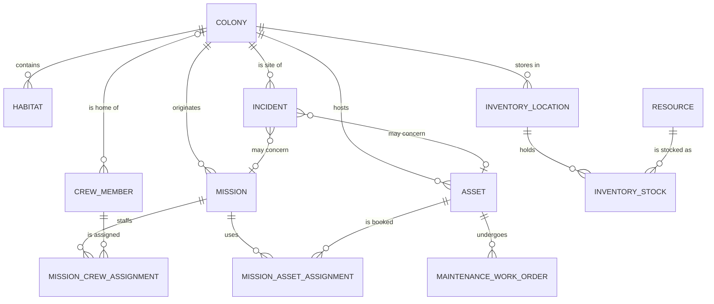
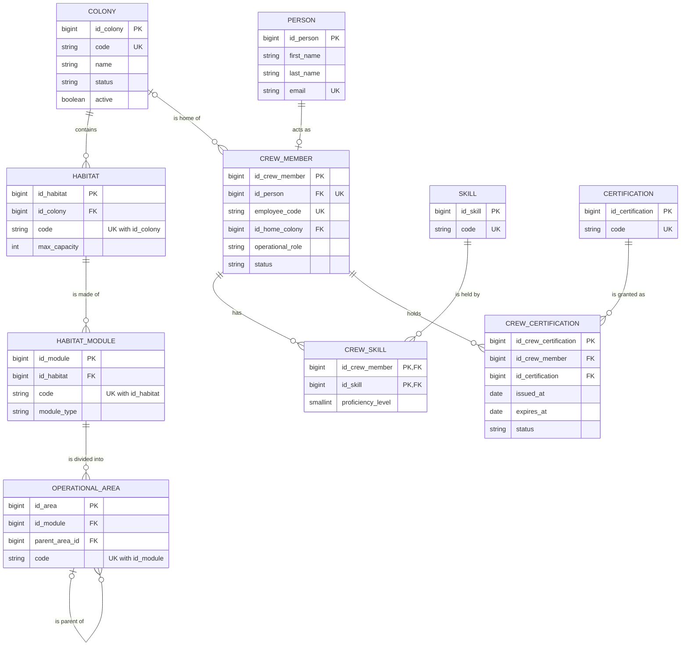
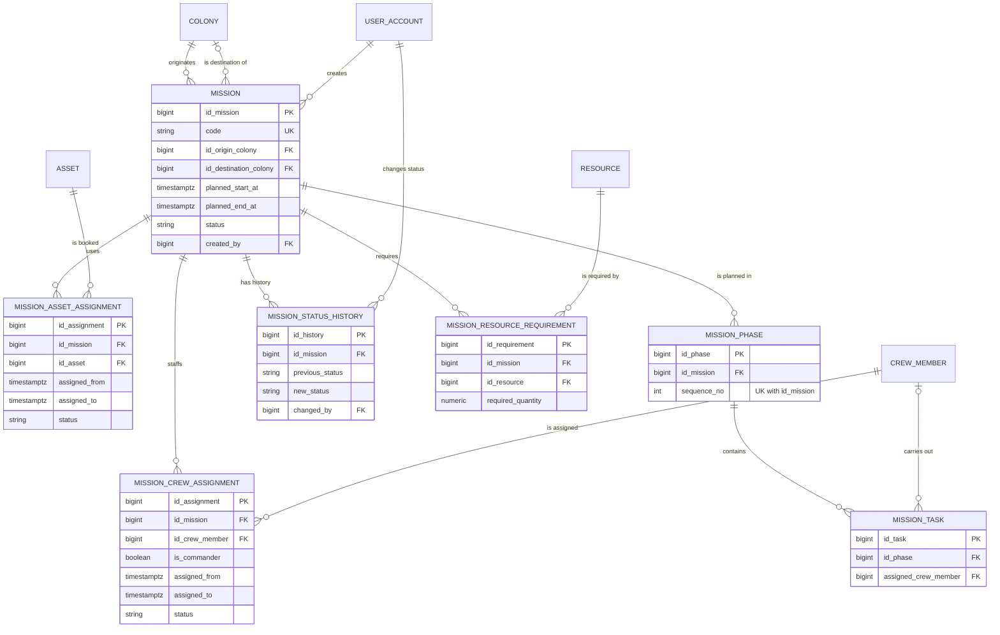
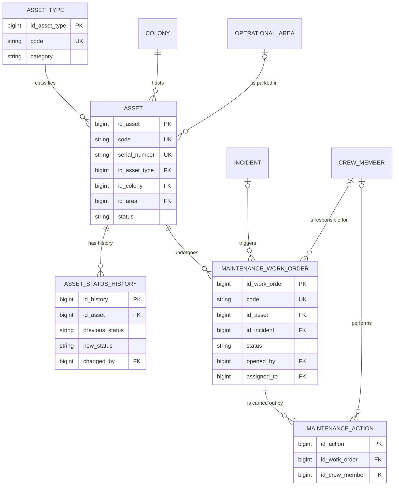
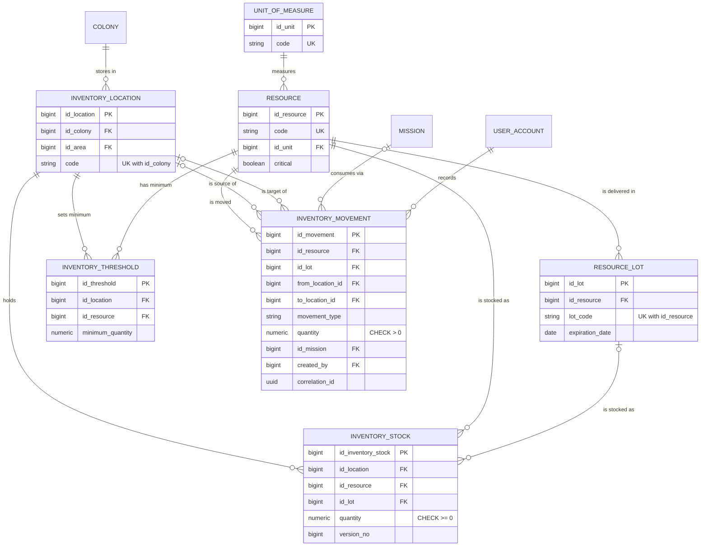
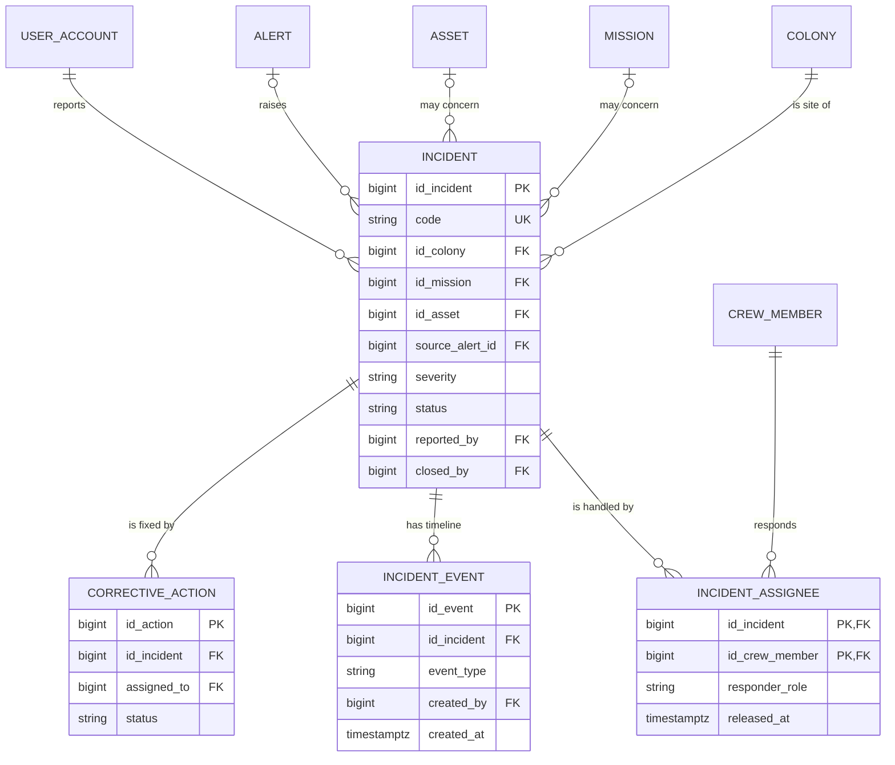

# Conceptual E-R model v1

Shared conceptual model of the AETHER MVP domains (TASK-001, #7). It describes the **entities,
relationships and cardinalities** behind the Flyway baseline ([ADR-0003](../adr/0003-database-schema-baseline.md))
and why they are shaped that way. The migrations in `backend/src/main/resources/db/migration/` remain
the source of truth for columns and types; this document is the source of truth for *meaning*.

Diagrams use [Mermaid `erDiagram`](https://mermaid.js.org/syntax/entityRelationshipDiagram.html),
which GitHub renders natively, so the model is versioned and reviewed like code. Only identifying
and business-key attributes are shown; everything else lives in the migrations.

Notation (crow's foot): `||` exactly one, `o|` zero or one, `}o` zero or many, `}|` one or many.

## Scope

| In this model (MVP, Sprint 1–3) | Outside this model (kept in the schema, documented later) |
|---------------------------------|------------------------------------------------------------|
| Colony structure and crew (ARES) | Science: laboratories, experiments, samples (V8) |
| Missions (PHOENIX) | Telemetry and alerts (V9), except the alert → incident link |
| Fleet and maintenance (TITAN) | IAM details: roles, permissions (V3, V14); see FUT-701 (#56) |
| Resources and logistics (ORION) | Notifications (V12), audit and outbox (V13) |
| Incidents and safety (HELIOS) | |

`user_account` appears in the diagrams only as the **actor** of auditable changes (BR-012): who
created a mission, moved stock, opened or closed an incident.

## Vocabulary

The backlog and mission packs are in Italian; the model uses the schema's English names.

| Backlog term | Entity |
|--------------|--------|
| Base / colonia | `COLONY` |
| Habitat, modulo, area operativa | `HABITAT`, `HABITAT_MODULE`, `OPERATIONAL_AREA` |
| Persona / membro equipaggio | `PERSON` + `CREW_MEMBER` |
| Veicolo / rover / mezzo | `ASSET` whose `ASSET_TYPE.category` is `VEHICLE` |
| Intervento di manutenzione | `MAINTENANCE_WORK_ORDER` |
| Risorsa, giacenza, soglia | `RESOURCE`, `INVENTORY_STOCK`, `INVENTORY_THRESHOLD` |
| Movimento, trasferimento | `INVENTORY_MOVEMENT` |
| Incidente, responder, timeline | `INCIDENT`, `INCIDENT_ASSIGNEE`, `INCIDENT_EVENT` |

## Overview

How the domains hang together. `COLONY` is the hub: almost every operational entity belongs to one.

## ARES: colony structure and crew

| Relationship | Cardinality | Why |
|--------------|-------------|-----|
| Colony → habitat → module → area | 1 : N at each level, child mandatory-parent | Physical containment: a module cannot exist outside a habitat. Child codes are unique only **within** their parent (`uq_habitat_code`, `uq_module_code`, `uq_area_code`), so two bases can both have `HAB-A`. |
| Area → sub-area | 0..1 : N, self-reference | Areas nest (a lab bay inside a lab). `ck_area_not_self_parent` stops trivial loops; deeper cycles are an application check. |
| Person → crew member | 1 : 0..1 | Not every person is crew (e.g. Earth-side staff with an account). Splitting `PERSON` from `CREW_MEMBER` keeps personal data in one place and operational data (role, home base, clearance) in another; `id_person` is `UNIQUE`, which makes the relationship 1 : 0..1. |
| Colony → crew member (home base) | 0..1 : N | A member may be in transit or not yet assigned (ARES-103: "base di assegnazione quando applicabile"), so the FK is nullable. |
| Crew member ↔ skill | N : M | Resolved by `CREW_SKILL`; the relationship carries its own attribute (`proficiency_level` 1–5), so it must be an entity, not a pair of FKs. Composite PK: a member has a skill at most once. |
| Crew member ↔ certification | N : M | Resolved by `CREW_CERTIFICATION` with a **surrogate** PK, unlike skills: the same certification can be renewed, so a member may hold several dated instances of it over time. Validity is `issued_at`–`expires_at` (BR-004). |

## PHOENIX: missions

| Relationship | Cardinality | Why |
|--------------|-------------|-----|
| Colony → mission (origin) | 1 : N, mandatory | PHX-201: a mission is always linked to an existing base. |
| Colony → mission (destination) | 0..1 : N | A destination is either another base or a free location on the surface (`destination_name` + coordinates), so the FK is optional. Two FKs to the same entity model two distinct roles. |
| Mission ↔ crew member | N : M | Resolved by `MISSION_CREW_ASSIGNMENT`. It is an entity, not a link table, because it has its own time window, role, commander flag and lifecycle (`ASSIGNED` → `CONFIRMED` → `RELEASED`/`CANCELLED`). A released assignment is kept, not deleted (BR-010). |
| Mission ↔ asset | N : M | Same reasoning, `MISSION_ASSET_ASSIGNMENT`. |
| Mission → commander | 1 : 0..1 | Modelled as `is_commander` on the assignment rather than an FK on `MISSION`: the commander must be an assigned crew member, which an FK on the mission could not guarantee. Draft missions may have none yet (PHX-204). |
| Mission → phase → task | 1 : N, ordered | `sequence_no` is unique within the mission. Tasks hang off phases, not missions, so the mission is reachable transitively and not stored twice. |
| Mission → status history | 1 : N | Every state change leaves a row with its author (BR-002, BR-012). The current state is also on `MISSION.status` for cheap reads. |
| Mission ↔ resource (requirement) | N : M | Resolved by `MISSION_RESOURCE_REQUIREMENT` with the required quantity; the same pattern exists for skills and certifications (`MISSION_SKILL_REQUIREMENT`, `MISSION_CERT_REQUIREMENT`). |

## TITAN: fleet and maintenance

| Relationship | Cardinality | Why |
|--------------|-------------|-----|
| Asset type → asset | 1 : N | Vehicles, rovers, generators, life-support units share one `ASSET` entity; the type's `category` (`VEHICLE`, …) distinguishes them. One entity keeps "asset booked by a mission" and "asset under maintenance" uniform across categories, instead of one table per kind. |
| Colony → asset | 1 : N, mandatory | Every asset belongs to a base; the area inside it is optional. |
| Asset → work order | 1 : N | An asset has many interventions over its life; a closed work order stays as history. |
| Incident → work order | 0..1 : N | Corrective maintenance can originate from an incident; preventive maintenance does not. |
| Asset → status history | 1 : N | Who changed the status and why (BR-012). TIT-306 reads `ASSET.status = MAINTENANCE` to block new mission bookings. |

## ORION: resources and logistics

| Relationship | Cardinality | Why |
|--------------|-------------|-----|
| Location ↔ resource (stock) | N : M | Resolved by `INVENTORY_STOCK`, which carries the quantity. Stock is per **location** (a warehouse inside a base), not per base: "stock per base" (ORI-402) is the sum over the base's locations. At most one row per (location, resource[, lot]) via two partial unique indexes, because `NULL` lots would otherwise defeat a plain unique constraint. |
| Location ↔ resource (threshold) | N : M | `INVENTORY_THRESHOLD`, one per pair (ORI-405). Kept apart from stock because a threshold is configuration that exists even when the stock row does not yet. |
| Resource → lot | 1 : N | Lots are optional: water has none, medicines do (expiry). |
| Movement → location (from / to) | two optional 0..1 : N roles | A receipt has only a target, a consumption only a source, a transfer both (`ck_inventory_locations`, `ck_inventory_different_locations`). An inter-base transfer (ORI-404) is one movement whose locations belong to different colonies, applied atomically to both stock rows; `correlation_id` groups the rows of one business operation. |
| Movement → mission | 0..1 : N | Consumption can be charged to a mission. |
| Stock vs movements | derived | `INVENTORY_STOCK.quantity` is the running total of the movement ledger (BR-006). It is stored, not computed on every read, and protected by `version_no` (optimistic locking) and `CHECK (quantity >= 0)` (BR-007). This is the one deliberate redundancy in the model. |

## HELIOS: incidents

| Relationship | Cardinality | Why |
|--------------|-------------|-----|
| Colony → incident | 1 : N, mandatory | Every incident happens somewhere (HEL-501, HEL-507 filter by base). |
| Mission / asset / alert → incident | 0..1 : N each | An incident *may* concern a mission, an asset or originate from a telemetry alert; none is mandatory. |
| Incident ↔ crew member (responders) | N : M | `INCIDENT_ASSIGNEE` with composite PK: a responder is assigned to an incident at most once; `released_at` ends the assignment without deleting it (HEL-503). |
| Incident → event | 1 : N | The timeline (HEL-504) is append-only: events are inserted, never updated. Enforcing immutability in the DB is a follow-up migration for HEL-504 (ADR-0003). |
| Incident → closure data | attributes, not an entity | `closed_by`, `closed_at`, `closure_reason` are required together when `status = 'CLOSED'` (`ck_incident_close_required`, BR-009). |

## Constraints worth knowing

Rules the model carries beyond plain keys. The [database README](README.md#business-rules-enforced-by-the-database)
lists the constraint names.

- **Unique business keys** (BR-001): every top-level entity has a `code` (`colony`, `mission`,
  `asset`, `incident`, `resource`, `maintenance_work_order`) or an equivalent (`employee_code`).
  Child entities are unique within their parent.
- **No double booking** (BR-003, BR-005): one crew member / one asset cannot have two active
  assignments whose `[assigned_from, assigned_to)` windows overlap. Enforced by GiST exclusion
  constraints, so the rule holds across missions, not just within one.
- **One commander** (PHX-204): at most one active assignment per mission with `is_commander`.
- **Non-negative stock** (BR-007) and **ledger-derived stock** (BR-006), see ORION above.
- **Time windows**: every `start/end` pair has `end > start` (or `>=` where zero-length is valid).
  All instants are `TIMESTAMPTZ` in UTC (BR-011).
- **Soft lifecycle** (BR-010): entities are deactivated (`active`, `status`, `deleted_at`,
  `released_at`) rather than deleted; history tables are append-only.
- **Attributable changes** (BR-012): state changes reference the `USER_ACCOUNT` that made them.
- **Controlled vocabularies**: statuses, priorities, severities and types are `CHECK` lists, and
  the allowed values are the ones in the migrations.

## Known gaps

Recorded here so stories pick them up; each is fixed by a **new** migration referencing its story.

- **Base membership history** (ARES-104, #18): `CREW_MEMBER.id_home_colony` holds only the
  current base, so past assignments are lost when it changes.
- **Base capacity** (ARES-102, #16 / ARES-104, #18): capacity exists twice, as the optional
  `COLONY.max_population` and as `HABITAT.max_capacity` per habitat. Which one ARES-104 enforces is
  an open question for the Product Owner. Occupancy is derived from `CREW_MEMBER.id_home_colony`,
  never stored.
- **Immutable incident timeline** (HEL-504, #46): append-only is today a convention, not a DB rule.
